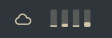
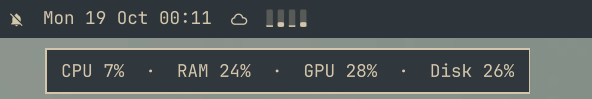

# Resources for the Omarchy bar

[](https://ko-fi.com/mike_g)

Four tiny meters in the Omarchy bar — CPU, RAM, GPU and disk — that show at a
glance how busy the machine is, in about the room of one icon.


## What you see



From left to right: CPU, RAM, GPU, disk. Each meter is a small track that
fills from the bottom with the current usage.
A meter turns to the theme's urgent colour (red above) when it crosses its
threshold:

| Meter | Shows | Turns urgent at |
|---|---|---|
| CPU | load over all cores since the previous poll | 80 %, held for three polls in a row (6 s), so short spikes don't flash |
| RAM | memory in use | 50 % |
| GPU | GPU utilisation, AMD or NVIDIA ([which GPU](#gpu-support)) | 50 % |
| Disk | space used on the root filesystem `/` | 70 % |

The animation is a real recording at normal speed: a few seconds of full
CPU load. The CPU meter fills at once and turns red after the third poll; the
GPU meter flashes red while the compositor works harder.

Hover the meters for the exact numbers:



Click them to open Activity (`btop`, the same as <kbd>Super</kbd> + <kbd>Ctrl</kbd> + <kbd>T</kbd>).

The meters use the bar's own foreground and urgent colours, so they match any
Omarchy theme.

## Install

```sh
omarchy plugin add https://github.com/yesm1ke/omarchy-plugin-resources --enable
```

`--enable` asks which bar section to put it in. To move it later, for example
right after the clock:

```sh
omarchy bar move io.github.yesm1ke.resources --after omarchy.clock
```

Update with `omarchy plugin update`.

## Remove

```sh
omarchy plugin remove io.github.yesm1ke.resources
```

This takes the widget off the bar and deletes the plugin. It writes nothing
else anywhere, so nothing is left behind.

## Dependencies

Nothing to install on Omarchy. It uses:

- `free` (procps-ng) and `df` (coreutils), present on every Arch system;
- `btop` for the click, which Omarchy ships;
- for the GPU meter only, the kernel's `amdgpu` driver on AMD (nothing to
  install, no extra permissions) or `nvidia-smi`, from the NVIDIA driver.
  Without either the GPU meter is simply not shown.

## How it works

Every two seconds one small shell command reads:

- CPU: the first line of `/proc/stat`. Usage is the change between two
  samples, so the CPU meter reads 0 % for the first two seconds after the shell
  starts.
- RAM: `free -b` (used of total).
- GPU: the AMD driver's busy percentage, or `nvidia-smi`; see below.
- Disk: `df --output=pcent /`.

Each value is tagged in the output, so a missing GPU reading cannot shift the
others. Nothing is written anywhere and nothing runs between polls. The
thresholds are constants at the top of `Resources.qml`.

Made for a horizontal bar (top or bottom).

## GPU support

The GPU meter shows how busy a GPU is, as its driver reports it. It is not
GPU memory use.

- AMD: the `gpu_busy_percent` file that the kernel's `amdgpu` driver keeps
  for each card, such as `/sys/class/drm/card1/device/gpu_busy_percent`.
  Every user may read it, so there is nothing to install: no ROCm, no
  `radeontop`, no extra groups.
- NVIDIA: `nvidia-smi --id=0 --query-gpu=utilization.gpu`, from the NVIDIA
  driver.

On every poll it looks again for the GPU to show:

1. The first AMD card with a valid reading. Cards are taken in glob order
   (`card0`, `card1`, …, where `card10` comes before `card2`), with no fixed
   number, so a machine whose only GPU is `card1` works. Connectors such as
   `card1-DP-1` and render nodes such as `renderD128` are not cards, and
   other vendors' cards are told apart by their PCI vendor ID.
2. Otherwise NVIDIA GPU 0, as `nvidia-smi` numbers them.
3. Otherwise none, and the GPU meter is hidden.

There is one meter, so with several GPUs it shows the first in that order,
never an average or a sum. On a laptop with an AMD iGPU and an NVIDIA dGPU
that is the AMD iGPU.

A reading counts only if it is a whole number from 0 to 100. A missing,
unreadable or malformed AMD reading (`N/A`, `101`, …) is skipped and the
next GPU tried. A failing `nvidia-smi`, or an answer from it that is not a
single such number (`[N/A]`, several lines, …), gives no reading. With no
reading the meter is hidden and reset to zero rather than left showing an old
or made-up value, and it comes back with the next poll that has one, without
restarting the shell.

Intel and other GPUs give no reading the plugin can use, so there the GPU
meter stays hidden.

## Tests

From the repository root:

```sh
python3 tests/test_resources.py -v
```

Nothing to install: they use `python3` and the tools the widget already
needs.

- The poll script is read straight out of `Resources.qml` and run against
  fake `/sys/class/drm` trees, with a fake `nvidia-smi` on a private `PATH`.
- With `quickshell` installed, the widget itself is loaded headless
  (`QT_QPA_PLATFORM=offscreen`) through `tests/harness.qml` to check
  `parseGpu` and whole polls. These use small stand-ins for Omarchy's
  `qs.Commons` and `qs.Ui`, written by the test.
- On Omarchy, live tests also run the unchanged script and widget with the
  installed shell modules on this machine's GPU, print what they read, and
  run `qmllint`.

Tests that need a missing tool are skipped. Quickshell runs with its own
temporary home and XDG folders, so the tests open no window, leave the running
shell alone and write nothing outside a temporary folder.

## License

MIT, see [LICENSE](LICENSE).
